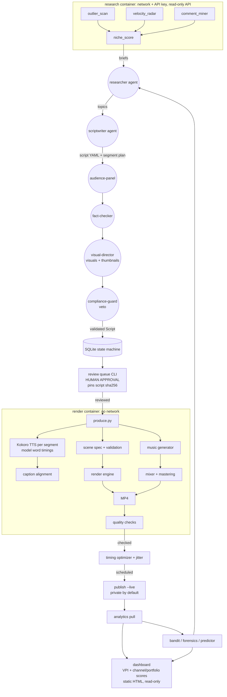
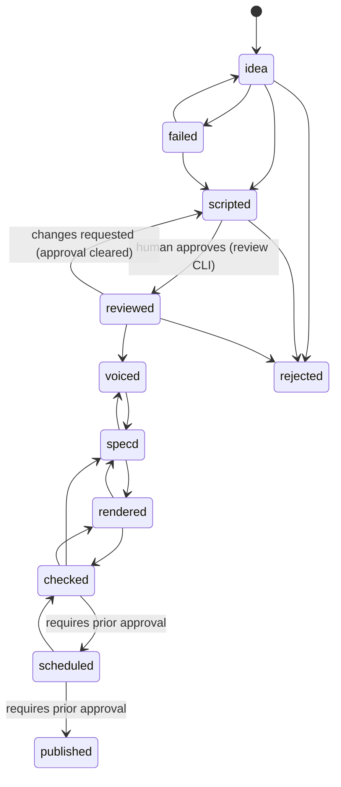

# Architecture

Claude Code agents do the thinking; deterministic Python does the work; everything runs locally in
hardened containers. Agents read compact summaries produced by scripts and write validated
artifacts (scripts, scene specs) that code checks before use.

## Data flow: idea → publish

## Video state machine (`src/db.py`)

Every transition is audited in `video_events` (actor, note, timestamp). Agents (`agent`, `claude`,
`bot`, `cron`) cannot approve. Stages are idempotent: re-running a stage in its current state is a
no-op, so cron runs and crashes resume safely.

## Modules
| Area | Modules | Notes |
|---|---|---|
| Common | `src/common/{paths,proc,ffmpeg,log,secrets,config,channels}.py` | safe paths, allowlisted subprocess, single FFmpeg resolver, JSON logs with redaction, `.env` secrets, validated rules + channel configs |
| DB | `src/db.py` | schema, state machine, review gate, jobs, quota, API cache, JSON CLI |
| Engine | `engine/core/*`, `engine/components/*`, `engine/schema/spec.py`, `engine/build.py`, `engine/cli.py` | see [ENGINE.md](ENGINE.md) |
| Audio | `src/audio/{tts,captions,music,dsp,mixer,analyze}.py` | see [AUDIO.md](AUDIO.md) |
| Production | `src/production/{script,produce}.py` | script model, orchestrator, word-anchored visuals |
| Quality | `src/quality/{frames,inspect}.py` (+ checks, step 13) | contact sheets, key frames |
| Research, compliance, review, publish, analytics, learning | `src/research/*`, `src/compliance/*`, `src/review/*`, `src/publish/*`, `src/analytics/*`, `src/learning/*` | built in steps 9-12 |
| Learning loop | `src/learning/arms.py`, `src/learning/bandit.py plan` | arm derived from each script in code; factored Thompson sampling picks the next formulas (ADR-034) |
| Dashboard | `src/dashboard/{score,collect,svg,render,build}.py` | success scoring (VPI, channel, portfolio, levers), read-only collection, static script-free HTML (ADR-033) |

## Agent ↔ script interfaces
Agents never execute generated shell. They call fixed entry points (allowed in `.claude/settings.json`) and exchange files:

| Agent | Calls | Reads | Writes (validated by) |
|---|---|---|---|
| researcher | `python -m src.research.*` | JSON summaries | topic briefs (markdown) |
| scriptwriter | `python -m src.db` | briefs, channel config | `data/scripts/<id>.yaml` (`src/production/script.py`) |
| visual-director | `produce --dry-run --script` | script, `scene_spec.schema.json` | segment `visual` blocks + thumbnail `focal`s (spec schema, `Script`), before review |
| compliance-guard | `python -m src.compliance.distinctness` | script, history | verdict JSON |
| analyst | `python -m src.analytics.*` | stats summaries | weekly brief |

## Production pipeline (`src/production/produce.py`)
1. Load + validate script and channel.
2. Narrate each segment in one pass (Kokoro, cached) → cut into sentences at the model's word timings → lay out with natural pauses.
3. Scene starts = first spoken word of each segment − 0.12 s (min 1.2 s scenes); resolve `at_word`, `until_word`, `count_at_word`, `reveal_words` anchors (and `at_word` on diagram nodes/edges and map markers/moves/paths, element-relative).
4. Validate the scene spec; generate music with risers on cuts; master to -14 LUFS / ≤ -1 dBTP.
5. Render in parallel → MP4 with audio; write manifest (spec, script, theme, seed, music arrangement, mix + render reports).
6. Review assets: contact sheet, key frames, audio image, analysis JSON.
Production mode (`--video-id`) refuses to run unless the video was approved by a human, and it renders only the script recorded at approval (its SHA-256 must still match). A passing quality run pins the render's SHA-256; upload re-verifies both (ADR-030).

## Reproducibility
`<id>.manifest.json` stores the full validated spec (theme name + seed inside), the script, the
music arrangement and all measurements. Frames are deterministic per (spec, theme, seed).
