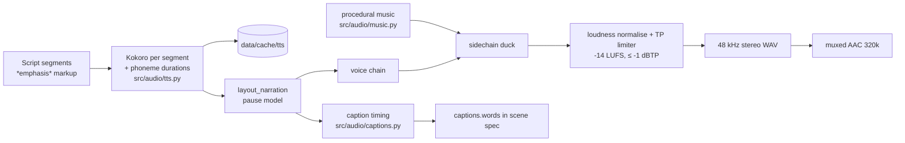

# Audio

Everything except the TTS model is our own code (NumPy/SciPy primitives).

## Voice (`src/audio/tts.py`)
- **Kokoro-82M v1.0** (Apache-2.0 weights) via `kokoro-onnx` + ONNX Runtime; phonemes from espeak-ng (bundled by `espeakng-loader`). 24 kHz mono output, resampled to 48 kHz for the mix. We load the **timestamped export** of the same weights (`models/kokoro/kokoro-v1.0-timestamped.onnx`), which also outputs per-phoneme durations (ADR-031).
- **One pass per segment** (`create_timed(continuous=True)`), so intonation flows across sentences instead of resetting at each full stop. `align_phoneme_words` maps the passage's phoneme groups to script words (DP over edit distance; handles espeak fusing "from the" or splitting "sixty-nine"). `cut_sentences` then cuts the passage into sentence clips at the gaps (60 ms lead-in, tail until the sound decays), so our pause model sets every gap.
- **Fallback:** without the timestamped model, or when a passage can't be aligned (logged as `word timing mismatch`), sentences are synthesized one at a time and captions use energy alignment.
- **Channel voices** are single stock Kokoro voices at speed 1.0 (`config/channels/*.yaml`): atlas `am_fenrir` (owner's pick), neon `af_heart`. Blends of low-grade voices and speeds above 1 both sounded more synthetic (A/B, 2026-10-15). No voice imitates a real person. Kokoro's own quality grades: `af_heart` A, `af_bella` A-, `bf_emma` B-, `am_fenrir`/`am_michael`/`am_puck` C+, `bm_george`/`bm_fable` C.
- **Natural pacing:** pauses depend on punctuation (`?` 0.44 s, `!` 0.36 s, `…` 0.62 s, `:` 0.30 s, `.` 0.34 s or 0.27 s for punchy sentences ≤ 5 words), +0.22 s at segment ends, ±12 % seeded jitter. No robotic uniform gaps.
- **Cache:** `data/cache/tts/<sha256(backend, model checksum, voice, text)>.wav` (+ `.json` word spans for passages).
- `SyntheticBackend` makes speech-shaped tones for CI/unit tests only; it is never used for output.
- Container note: phonemizer copies `libespeak-ng.so` to a temp dir and `dlopen`s it, which fails on a `noexec` `/tmp`. A dedicated 32 MB exec tmpfs (`/var/tmp/dlopen`) is used only during that load (see LEARNINGS).

## Captions (`src/audio/captions.py`)
With the timestamped model, word times come straight from the model's phoneme durations (above). The energy-based fallback, per sentence:
1. Speech onset/offset from a 10 ms energy envelope (-38 dB relative floor).
2. Internal pauses ≥ 70 ms are matched to clause punctuation (`, ; : —`) by expected position (within 25 % of the span), so clause boundaries land where the voice actually pauses.
3. Within each clause, time is distributed by word weight = syllables + 0.35 + 0.02·letters (our syllable counter handles silent -e, -ed, hiatus pairs, years and numbers).
`*word*` in scripts marks emphasis (accent colour in captions); asterisks are stripped before TTS.
Future refinement: forced alignment if drift is noticed in review.

## Music (`src/audio/music.py`)
Styles: `cinematic` (70-84 bpm, minor, 2-bar chords, detuned saw pads + sub, Karplus-Strong plucks, big reverb), `synthwave` (96-108 bpm, arpeggiated pulse, 8th-note bass, four-on-the-floor kick with sidechain pump), `lofi` (dorian 7ths, swung hats, lazy kick/snare), `ambient` (lydian, slow pads). The channel seed picks tempo, key and progression; arrangements follow an intro → body → outro energy curve. Sound design: a noise riser that ends exactly on each scene cut and a low impact under the hook. Pads and leads get a -4 dB dip at 2.5 kHz so the voice owns the presence range.
Performance: combs, allpasses and Karplus-Strong use block-wise recursion (one vectorised op per delay length), ~0.2 s per 14 s of music (40× faster than `lfilter` with long sparse delays). Property tests prove equivalence with `scipy.signal.lfilter`.

## Mixing (`src/audio/mixer.py`, `src/audio/dsp.py`)
- Voice chain (kept light; heavy processing made Kokoro sound more synthetic): 75 Hz HPF → -1.5 dB @ 260 Hz → +1.2 dB @ 3.2 kHz → +0.5 dB air shelf @ 10 kHz → split-band de-esser (5-9.5 kHz, ≤ 5 dB) → soft-knee RMS compressor (2.2:1, -24 dB, 12 ms attack, +3 dB makeup).
- **Room tone:** a seeded, band-limited (120 Hz-4.5 kHz) noise floor 54 dB under the voice's loudness, so pauses aren't digital silence (`master(room_db=...)`; None disables it).
- Music is placed at **voice − 12 dB** (channel-configurable) and ducked **8 dB** under speech (30 ms attack, 450 ms release), breathing up in pauses.
- Master: gain to **-14 LUFS integrated** (our ITU-R BS.1770-4 meter with absolute and relative gating), then a lookahead **true-peak limiter** (4× oversampled detection, ceiling -1.3 dBTP), iterated until within 0.2 LU.
- Verified: our meter matches FFmpeg `ebur128` (e.g. -14.02 vs -14.0 LUFS, TP -1.3 vs -1.3). Reference test: 997 Hz sine at -20 dBFS → -23.0 LUFS.

## Analysis (`src/audio/analyze.py`)
Loudness, true peak, clipped samples, silence gaps > 1.5 s, speech-to-music ratio, FFmpeg cross-check, and a waveform + log-frequency spectrogram PNG drawn with our canvas.

## Targets (from `config/rules.yaml`)
| Metric | Target |
|---|---|
| Integrated loudness | -14 LUFS ± 1 |
| True peak | ≤ -1 dBTP |
| Silence gaps | none > 1.5 s |
| Clipping | 0 samples |
