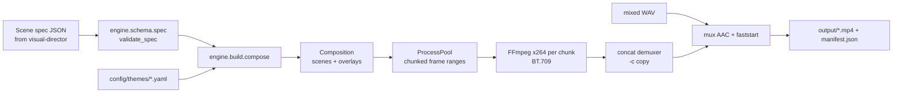

# Render engine

Our own motion-graphics renderer: Python + skia-python (2D raster) → FFmpeg. No Remotion, no
stock footage. Everything on screen is drawn by this code.

## Pipeline


## Core modules (`engine/core/`)
| Module | Role |
|---|---|
| `easing.py` | 30+ easing curves (poly, sine, expo, circ, back/overshoot, elastic, bounce, physical `spring(k,d)`, CSS `cubic_bezier`). `get_easing(name)` parses parameterised names. All satisfy f(0)=0, f(1)=1 (property-tested). |
| `timeline.py` | `Keyframe`, `Track` (scalar/tuple interpolation, destination-keyframe easing), `tween`, `stagger` (forward/reverse/center). |
| `color.py` | Hex parsing, mixing, WCAG luminance + contrast ratio. |
| `canvas.py` | **The only module that imports skia.** `Canvas` (shapes, paths with trim/dash, gradients, glows, text with tracking/stroke/shadow, layers with alpha/blur/blend, pictures with channel masks), `PathBuilder` (incl. Catmull-Rom `smooth`), `Fonts` (variable-font axes), `Surface` (numpy-backed RGBA). |
| `text.py` | Balanced line breaking (DP minimising squared slack) and `fit_text` (largest size that fits a box/line limit). |
| `theme.py` | Pydantic `Theme`: palette, font roles, motion language, transition, captions, background. |
| `scene.py` | `Node` (animated x/y/scale/rotation/opacity), `Group`, `FnNode`, `CachedLayer`, `Scene`, `Composition`, `FrameRenderer` (incl. motion blur by sub-frame accumulation), transition registry. |
| `geo.py` | Natural Earth loading, Mercator / Equal Earth / equirectangular projections + morphs, spherical area, Rodrigues rotation, great-circle densify, antimeridian unwrap, graticule. |
| `layout.py` | Formats (1080×1920, 1920×1080), safe zones from `config/rules.yaml`, `make_context`. |
| `render.py` | Parallel chunked render → FFmpeg segments → concat → mux; resource limits; benchmark logging; `render_still`; manifests. |

### Timing model
Scenes have explicit global `start` times (aligned to narration). A scene stays on screen until the
next scene's transition completes. The transition into scene B runs over
`[B.start, B.start + duration]` while B's entrance animations play. Nodes receive local time.
Overlays (captions, progress bar) use global time.

### Determinism
`RenderContext.rng(key)` derives a NumPy generator from `sha256(seed:key)`, so frames do not depend
on worker count or render order. The manifest next to each output stores the full spec (which
includes theme name and seed) plus render benchmark.

### Performance
Each worker renders a contiguous frame chunk straight into its own FFmpeg process (no frame IPC).
Chunks = 3 × workers for load balance. Static layers (background base, vignette, grain plates)
are cached per worker. Measured: 1080×1920@30, 12 workers: **~41-46 fps render (1.4-1.5× realtime)**
on the build machine (24 vCPU Docker VM), including encode.

## Scene spec
JSON Schema: [`engine/schema/scene_spec.schema.json`](../engine/schema/scene_spec.schema.json)
(regenerate: `python -m engine.schema.spec --export`). Validation rejects unknown fields, caps
string/list sizes, bounds numbers, checks easing names, enforces strictly increasing scene
starts, ≤ 7 words per title, Shorts ≤ 180 s, and global render limits.

```json
{
  "version": 1, "id": "mercator-short", "format": "short", "theme": "atlas", "seed": 11,
  "fps": 30, "duration": 16.0,
  "scenes": [
    {"id": "s1", "start": 0.0, "elements": [
      {"type": "KineticTitle", "text": "Every map you know is lying", "kicker": "Geography",
       "emphasis": ["lying"], "size": "xl", "underline": true}]},
    {"id": "s2", "start": 4.0, "elements": [
      {"type": "StatCounter", "value": 14, "suffix": "×", "label": "Africa vs. Greenland, real area"}]},
    {"id": "s3", "start": 8.0, "transition": {"kind": "zoom", "duration": 0.5, "easing": "in_out_expo"},
     "elements": [{"type": "QuoteCard", "quote": "The map is not the territory.",
                   "attribution": "Alfred Korzybski, 1931", "highlight": ["territory"]}]}
  ],
  "captions": {"enabled": true, "words": [{"w": "Most", "start": 0.3, "end": 0.5}]}
}
```
Full example: `tests/fixtures/specs/components_demo.json`. Render it:
`bash scripts/task.sh run python -m engine.cli render tests/fixtures/specs/components_demo.json output/demo/x.mp4 [--theme neon] [--format long]`.

Element times (`start`/`end`) are relative to their scene. `region` is one of `full`, `center`,
`upper`, `lower`, `top`, `left`, `right`: regions sit inside the safe zone **and above the caption
band**, and adapt per format (left/right stack vertically on Shorts).

## Components (`engine/components/`)
| Component | Notes |
|---|---|
| `KineticTitle` | ≤ 7 words; entrances `mask` (words rise from behind a line clip), `rise`, `pop`, `slide`; staggered by theme; emphasis words in accent with glow; kicker; underline draw-on. |
| `WordCaptions` | Speech-rhythm paging (punctuation, pauses, max words/chars); styles `pop`, `box` (gliding highlight), `karaoke`; outlined + shadowed text. |
| `StatCounter` | Count-up with out-expo, jitter-free layout, landing pulse + glow, optional progress ring, compact formatting. |
| `ListReveal` | ≤ 6 items; slide-in rows, popping numbered badges, focus bar on current item, earlier items dim. |
| `QuoteCard` | Card with drop shadow, accent bar, big quote mark, word-by-word reveal, highlighter swipe. |
| Transitions | `wipe` (angled, accent leading bar, alternating direction), `zoom` (push-through blur), `slide` (vertical on Shorts), `glitch` (slice displacement + RGB split), `fade`, `iris`, `cut`. |
| `ThemedBackground` | Cached gradient + pattern (`paper` hairlines/fibres, `grid` with perspective floor, `aurora`), drifting light pools, vignette, 12 fps film grain. |
| `ComparisonSplit` | Two quantities to honest scale: area-true squares (side ∝ √value) or linear bars; values count up; ratio badge. |
| `AnimatedMap` | Natural Earth 50m/110m countries; camera pan/zoom (log-even zoom); projections `mercator`, `equal_earth`, `equirect` with animated **projection morph**; highlights by country (ADM0_A3) or continent; **true-size moves** (rigid sphere rotation, re-projected live, dashed ghost of the distorted shape); great-circle routes with dashed draw-on; pulsing labelled markers; graticule. Geometry is cached per projection state; camera moves are canvas transforms. |
| `LineChartReveal` | Smoothed line draws left→right with area fill, glowing head and live value label; 1-2-5 "nice" ticks; zero baseline unless data is far from zero. |
| `BarRace` | Ranked horizontal bars interpolating values and rank positions between frames; label column auto-fits; frame label (year) watermark. |
| `Timeline` | Spine draws on; events pop in (vertical on Shorts, horizontal on long-form); current/highlighted event glows. |
| `DiagramBuild` | Nodes (normalised x/y) pop in; curved arrows draw between node edges with arrowheads and edge labels. |
| `IconScene` | 12 code-drawn vector icons (globe, clock, bolt, ship, mountain, atom, chart, warning, coin, crown, book, flame) that draw on, then idle (spin, bob, orbit, flicker). |
| `ParticleBackground` | Stateless analytic particles (`dust`, `embers`, `stars`, `snow`), deterministic per seed. |

## Adding a component
1. Add a `…Spec` pydantic model in `engine/schema/spec.py` (strict, bounded fields, `type: Literal[...]`) and include it in `ElementSpec`.
2. Implement a `Node` subclass in `engine/components/<name>.py` taking `(spec, ctx)`; compute layout in `__init__`, draw in `render(cv, t, ctx)` using only `Canvas` and the theme (`ctx.theme.color(...)`, font roles, `entrance(...)`).
3. Register it (core set in `engine/build.py`, others in `engine/components/extra.py`).
4. Re-export the JSON Schema, add a scene to a fixture spec, add tests, render and review a contact sheet.

## Adding a theme
Copy `config/themes/atlas.yaml`, change palette (text/text_muted must reach ≥ 4.5:1 contrast on
`bg`, `bg2`, `surface`; a test enforces this), font roles (families from `engine/core/canvas.FONT_FILES`),
motion (easings, stagger 30-80 ms), transition, caption style and background treatment.
